# TBK-MINI-CLICKY + Dongle ZMK config

ZMK firmware for a wireless **TBK Mini split keyboard** (43 keys) with a **USB/BLE dongle**.
The halves use the TBK pinout (`tbk_nini` shield) and the keymap from the
`dongle_trackball` branch. The Bluetooth name (`TBK-MINI-CLICKY`) comes from the `windows`
branch.
The dongle runs the keymap and connects to the computer. It also has a **PAW3395 optical
sensor** (for a trackball or mouse) and **5 mouse buttons**.

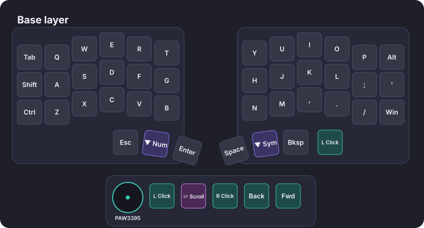

## Contents

- [Hardware](#hardware)
- [Architecture](#architecture)
- [Halves pinout](#halves-pinout)
- [Dongle wiring](#dongle-wiring)
- [Keymap](#keymap)
- [Building](#building)
- [Flashing & first pairing](#flashing--first-pairing)
- [Customizing](#customizing)
- [Repository layout](#repository-layout)
- [Troubleshooting](#troubleshooting)

## Hardware

| Part            | Board         | Role                    | Shield         |
| --------------- | ------------- | ----------------------- | -------------- |
| Dongle          | nice!nano v2  | Split **central**, connects to the host | `corne_dongle` |
| Left half       | nice!nano v2  | Split peripheral        | `tbk_nini_left`  |
| Right half      | nice!nano v2  | Split peripheral        | `tbk_nini_right` |

Other dongle parts:

- PAW3395 sensor breakout (SPI). The driver is [badjeff/zmk-paw3395-driver](https://github.com/badjeff/zmk-paw3395-driver),
  because ZMK doesn't ship a PAW3395 driver.
- 5 momentary switches, each wired between a GPIO and GND.

## Architecture

```
            ┌──────────────┐  BLE   ┌───────────────────────────┐  USB / BLE  ┌──────────┐
            │  Left half   │ ─────▶ │          Dongle           │ ──────────▶ │ Computer │
            │ (peripheral) │        │  (central, owns keymap)   │             └──────────┘
            └──────────────┘        │  • PAW3395 → pointer      │
            ┌──────────────┐  BLE   │  • 5 buttons → keymap     │
            │  Right half  │ ─────▶ │    positions 43–47        │
            │ (peripheral) │        └───────────────────────────┘
            └──────────────┘
```

- Both halves are **peripherals**. They only scan their matrix and send key positions
  to the dongle. The `tbk_nini` shield never makes a half the central.
- The dongle is the **central**. It runs the keymap and all behaviors, handles the BT
  profiles, and sends HID reports. It accepts **2** peripherals
  (`ZMK_SPLIT_BLE_CENTRAL_PERIPHERALS=2`).
- The halves' batteries are reported to the host through the dongle (battery fetching and
  proxy are on).
- The halves use less power because they never talk to the host. Plug the dongle into
  USB and it never needs charging.

### Key positions

The dongle's matrix transform uses positions **0–42** for the 43-key TBK layout: the
Corne 3×6 + 3 thumbs per side, plus one extra key on the right half at RC(3,9), outside
the thumb cluster. Its own buttons are **row 4**, positions **43–47**. A `zmk,kscan-composite` with
`row-offset = <4>` moves the 5 direct-wired buttons onto that row, so they can't collide
with the halves' keys.

## Halves pinout

Defined in `boards/shields/tbk_nini/`. Same as a stock Corne except **row 0 is on D8**
(Corne uses D4), plus the 43rd key. Diodes are col2row.

| Matrix | Pro Micro pins (left half)       | Right half                  |
| ------ | -------------------------------- | --------------------------- |
| Rows 0–3 | D8, D5, D6, D7                 | same                        |
| Cols 0–5 | D21, D20, D19, D18, D15, D14   | mirrored: D14, D15, D18, D19, D20, D21 |

The halves have no trackball. The sensor is on the dongle.

## Dongle wiring

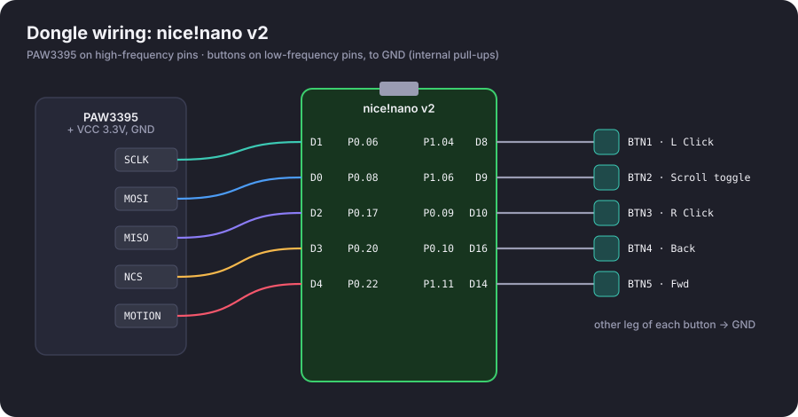

The PAW3395 uses **only high-frequency pins**. The nRF52840 datasheet marks
some GPIOs "low frequency I/O only" (≤10 kHz): P0.09/P0.10 (the NFC pins) and the
P1.xx pins near the radio. Those are fine for buttons but not for the sensor's SPI bus,
so the 5 buttons get the low-frequency pins.

| Signal          | Pro Micro pin | nRF52840 pin | Notes                               |
| --------------- | ------------- | ------------ | ----------------------------------- |
| PAW3395 SCLK    | D1            | P0.06        | SPIM2 SCK                           |
| PAW3395 MOSI    | D0            | P0.08        | SPIM2 MOSI                          |
| PAW3395 MISO    | D2            | P0.17        | SPIM2 MISO                          |
| PAW3395 NCS     | D3            | P0.20        | chip select, active low             |
| PAW3395 MOTION  | D4            | P0.22        | interrupt, active low, pull-up      |
| PAW3395 VCC/GND | VCC / GND     |              | check your breakout's voltage       |
| BTN1            | D8            | P1.04        | → GND, internal pull-up             |
| BTN2            | D9            | P1.06        | → GND                               |
| BTN3            | D10           | P0.09        | → GND (NFC pin, enabled as GPIO)    |
| BTN4            | D16           | P0.10        | → GND (NFC pin, enabled as GPIO)    |
| BTN5            | D14           | P1.11        | → GND                               |

P0.09/P0.10 default to the NFC antenna. The overlay turns them into GPIOs with
`&uicr { nfct-pins-as-gpios; }`. P0.17/P0.20 are the nice!nano's default I2C pins, but
I2C is disabled on the dongle, so they're free for SPI.

The sensor runs on `spi2` at 4 MHz, at **800 CPI** by default. See [Customizing](#customizing).

## Keymap

Ten layers, ported from the `dongle_trackball` branch's `tbk_nini.keymap`. Each layer
adds a row for the 5 dongle buttons.

| Layer | How to reach it | What it has |
| ----- | --------------- | ----------- |
| **Base** (DEF) | default | QWERTY; the extra right key is left click |
| **Num** | hold left middle thumb | numbers, arrows, media, mouse buttons; hold `A` position for Snipe, `G` for Scroll |
| **Sym** | hold right middle thumb | symbols |
| **Sys** | Num or Sym + the other middle thumb | F-keys, mouse movement keys, BT profiles 1–5, BT clear all, Alt+F4 |
| **Game** | combo, see below | WASD shifted one column right, `T` `G` `B` on the outer column |
| **Game Num** | hold left middle thumb in Game | 1–0 on the left |
| **One-hand** / **One-hand 2** | combo, see below | hold the left middle thumb to mirror the right half onto the left |
| **Scroll** | toggle with dongle BTN2, or hold from Num | sensor scrolls instead of moving the pointer |
| **Snipe** | hold from Num | pointer at ⅓ speed |

Combos (not shown in the images):

| Keys (pressed together)              | Action                           |
| ------------------------------------ | -------------------------------- |
| `Shift` `A` `S` (positions 12–14)    | Switch to the **Game** layer     |
| `Ctrl` `Z` `X` (positions 24–26)     | Switch back to **Base**          |
| `Tab` `Q` `W` (positions 0–2)        | Switch to the **One-hand** layer |

Switching layers with a combo also turns scroll mode off.

On `dongle_trackball` the sensor only moved while Num was held. Here the pointer always
moves, because the sensor is the dongle's main mouse. Snipe is now ⅓ speed. It was a
speed-up on that branch.

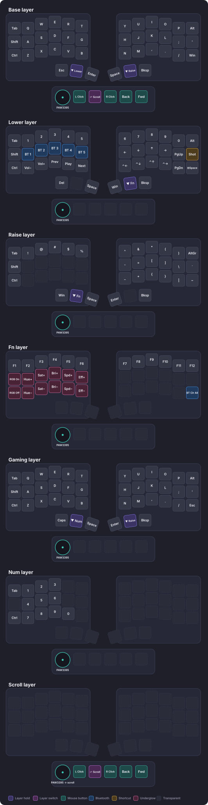

<details>
<summary>Individual layers</summary>


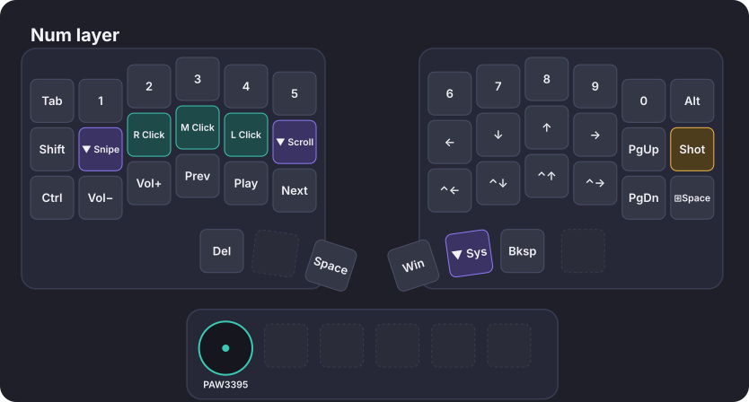
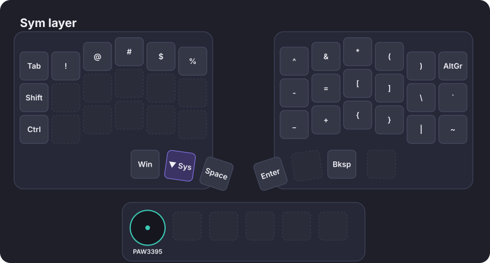
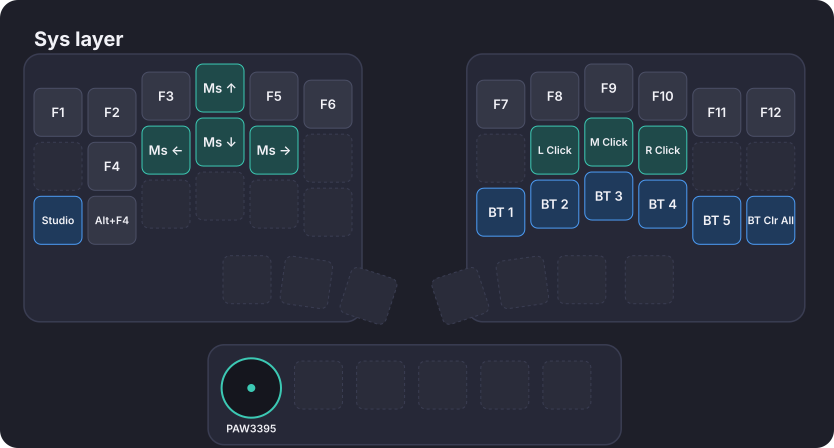
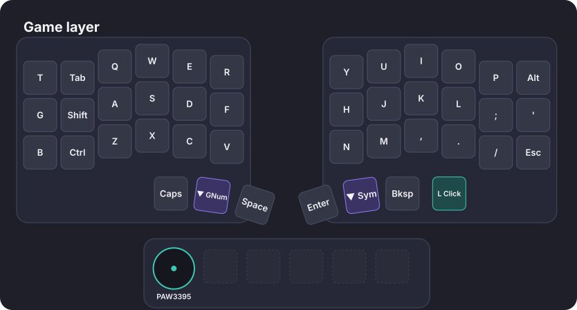
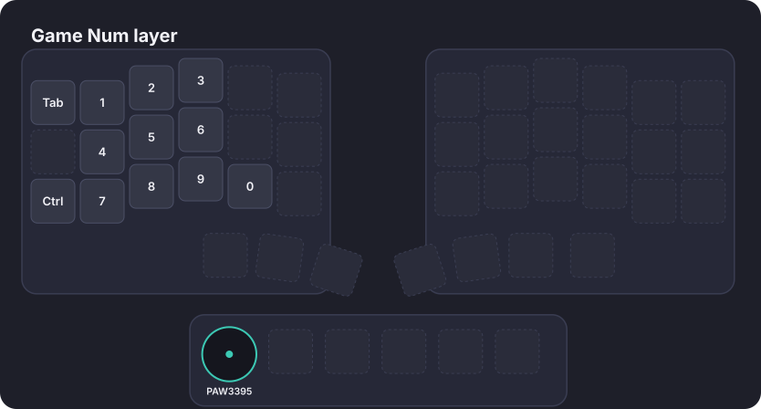
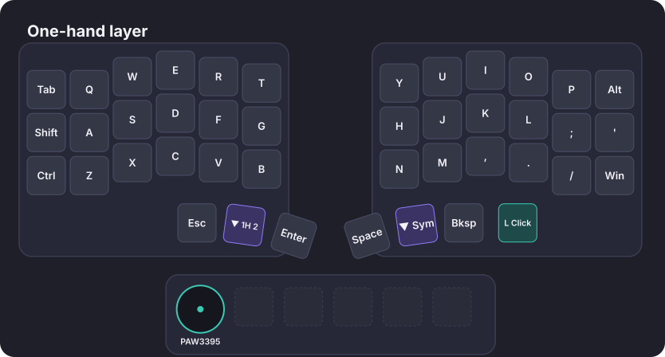
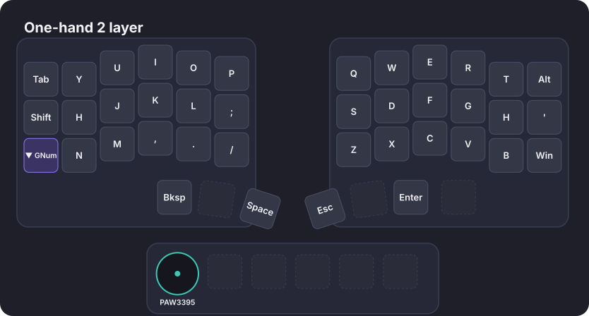
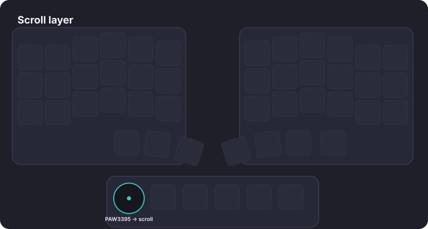
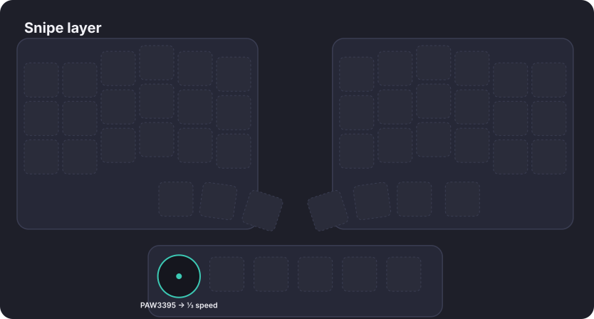

</details>

| Dongle button | Base layer         |
| ------------- | ------------------ |
| BTN1          | Left click         |
| BTN2          | Scroll mode toggle |
| BTN3          | Right click        |
| BTN4          | Back (MB4)         |
| BTN5          | Forward (MB5)      |

Other layers leave them transparent, so they work the same on every layer.

**Scroll mode:** press BTN2 once and moving the sensor scrolls (vertical and horizontal).
Press BTN2 again to go back to pointer mode. It's a toggle, not a hold, and there is no
middle click on the dongle. Middle click is on Num and Sys.

> **Bootloader:** this keymap has no bootloader key. To flash any board, double-tap its
> reset button. The `Studio` key on Sys does nothing, because ZMK Studio isn't enabled.

The images are generated from the keymap. After editing
[`config/corne_dongle.keymap`](config/corne_dongle.keymap), regenerate them with:

```bash
python3 scripts/gen_layout_svg.py .
```

## Building

### GitHub Actions (default)

Push the branch. The workflow in `.github/workflows/build.yml` builds every entry in
[`build.yaml`](build.yaml) and uploads a `firmware` artifact with:

- `corne_dongle-nice_nano-zmk.uf2`
- `tbk_nini_left-nice_nano-zmk.uf2`
- `tbk_nini_right-nice_nano-zmk.uf2`
- `settings_reset-nice_nano-zmk.uf2`

### Local build

This needs a west workspace with ZMK and the Zephyr SDK, plus a clone of
`zmk-paw3395-driver`. Run from the workspace root:

```bash
R=/path/to/this/repo

# Dongle (needs the PAW3395 driver module)
west build -p -s zmk/app -d build/corne_dongle -b nice_nano@2.0.0//zmk -- \
  -DSHIELD=corne_dongle -DZMK_CONFIG=$R/config \
  "-DZMK_EXTRA_MODULES=$R;$PWD/zmk-paw3395-driver"

# Halves
west build -p -s zmk/app -d build/tbk_left -b nice_nano@2.0.0//zmk -- \
  -DSHIELD=tbk_nini_left -DZMK_CONFIG=$R/config -DZMK_EXTRA_MODULES=$R
west build -p -s zmk/app -d build/tbk_right -b nice_nano@2.0.0//zmk -- \
  -DSHIELD=tbk_nini_right -DZMK_CONFIG=$R/config -DZMK_EXTRA_MODULES=$R
```

Each build writes its firmware to `build/<name>/zephyr/zmk.uf2`.

## Flashing & first pairing

1. **Flash `settings_reset` to all three boards** (dongle, left, right). This clears old
   bonds. It matters most if the left half used to be the central.
2. Flash `corne_dongle` to the dongle, `tbk_nini_left` to the left half and
   `tbk_nini_right` to the right half. To flash a board: double-tap reset, then copy the `.uf2` to the
   `NICENANO` drive.
3. Power the dongle (USB) and both halves. The halves pair with the dongle automatically.
4. Connect the computer:
   - **USB:** works immediately.
   - **Bluetooth:** pair with `TBK-MINI-CLICKY`. On Sys, the right bottom row selects BT
     profiles 1–5 and the bottom-right key clears all profiles.

## Customizing

| What                     | Where                                                        |
| ------------------------ | ------------------------------------------------------------ |
| Keymap / dongle buttons  | `config/corne_dongle.keymap` (positions 43–47 = last row)    |
| Sensor CPI               | `cpi = <800>;` in `boards/shields/corne_dongle/corne_dongle.overlay` (50–26000, step 50) |
| Sensor orientation       | uncomment `swap-xy;`, `invert-x;`, `invert-y;` in the overlay |
| Report rate              | `CONFIG_PAW3395_REPORT_INTERVAL_MIN` in `corne_dongle.conf` (try `8` on USB) |
| Dongle pins              | `corne_dongle.overlay` (keep SPI on P0.xx high-frequency pins) |
| Halves' pins             | `boards/shields/tbk_nini/` (`tbk_nini.dtsi` rows, `tbk_nini_left/right.overlay` cols) |
| Keyboard / BT name       | `ZMK_KEYBOARD_NAME` in `boards/shields/corne_dongle/Kconfig.defconfig` |
| Halves' settings         | `config/tbk_nini.conf` (the dongle doesn't load it)          |
| Scroll speed             | `&zip_scroll_scaler 1 16` in `config/corne_dongle.keymap` (bigger divisor = slower) |
| Snipe speed              | `&zip_xy_scaler 1 3` in `config/corne_dongle.keymap`         |

See ZMK [input processors](https://zmk.dev/docs/keymaps/input-processors) for more sensor
tweaks.

## Repository layout

```
.
├── build.yaml                         # CI build matrix (dongle, left, right, reset)
├── boards/shields/tbk_nini/           # TBK halves shield (43 keys, row 0 on D8)
│   ├── tbk_nini.dtsi                  # rows, matrix transform
│   ├── tbk_nini_left/right.overlay    # columns
│   └── tbk_nini.keymap                # placeholder; halves don't run a keymap
├── boards/shields/corne_dongle/       # custom dongle shield
│   ├── Kconfig.shield
│   ├── Kconfig.defconfig              # central role, 2 peripherals, keyboard name
│   ├── corne_dongle.overlay           # buttons kscan, matrix transform, PAW3395 on SPI
│   ├── corne_dongle.conf              # pointing + PAW3395 + battery proxy
│   └── corne_dongle.zmk.yml
├── config/
│   ├── west.yml                       # ZMK + badjeff/zmk-paw3395-driver
│   ├── corne_dongle.keymap            # the keymap that's actually used (48 keys)
│   └── tbk_nini.conf                  # applies to the halves
├── docs/                              # generated layout + wiring SVGs
├── scripts/gen_layout_svg.py          # regenerates docs/*.svg from the keymap
└── zephyr/module.yml                  # makes this repo a Zephyr module (custom shield)
```

## Troubleshooting

- **Halves don't connect:** flash `settings_reset` to all three boards, then reflash the
  real firmware. A left half that used to be central keeps old bonds.
- **Sensor dead:** check the MOTION/NCS wiring and the breakout's supply voltage. Then
  build with `CONFIG_PAW3395_LOG_LEVEL_DBG=y` and `CONFIG_ZMK_USB_LOGGING=y`, and watch
  the dongle's USB serial output.
- **Pointer moves the wrong way:** use `swap-xy` / `invert-x` / `invert-y` in the overlay.
- **Scroll goes the wrong way:** append `&zip_scroll_transform INPUT_TRANSFORM_Y_INVERT`
  (and/or `INPUT_TRANSFORM_X_INVERT`) to the scroller's `input-processors` in
  `corne_dongle.keymap`.
- **Sensor takes a while to start:** set `CONFIG_PAW3395_INIT_POWER_UP_EXTRA_DELAY_MS`.
- **Keys on the wrong positions:** the halves' transform (`tbk_nini.dtsi`) and the first
  43 entries of `dongle_transform` must match. `corne_dongle.keymap` must have exactly 48
  bindings per layer.
- **A whole row is dead:** row 0 is on D8 (TBK), not D4 (Corne). Check your wiring
  against [Halves pinout](#halves-pinout).
